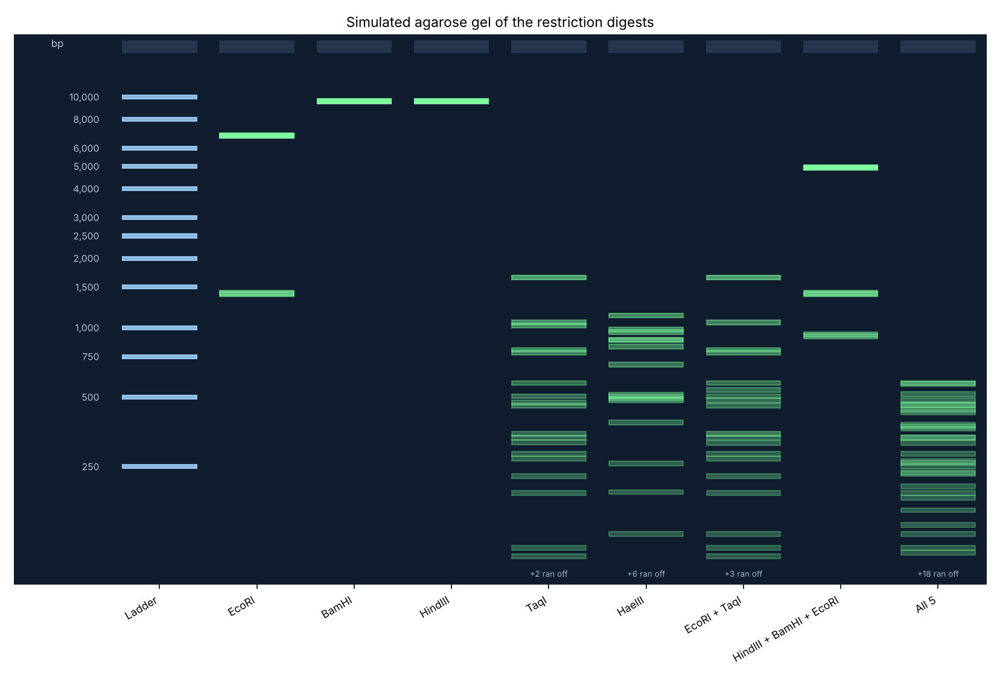

# Lab 07 - Restriction Enzymes

## Task

Take a DNA sequence from NCBI (a bacterial or viral genome) and cut it with 5 restriction enzymes.

- **Input:** the recognised sequence of each enzyme and the DNA to be cut.
- **Output:**
  1. the number of cuts for each enzyme
  2. the cut positions and the fragment lengths
  3. a simulated electrophoresis gel based on the enzymes used

## DNA used

*Yersinia pestis* plasmid pPCP1, NCBI RefSeq NC_005816.1, 9,609 bp, circular.

I first tried the 2,739 bp virus from lab 03. There, BamHI and HindIII cut only once and the gel looked almost empty. The plasmid is longer, all 5 enzymes cut it, and because it is a circle I had to think about how to count the pieces. The virus can still be used as an option.

## Enzymes (from the board)

| Enzyme | Site | Cut | Ends | Overhang | From |
|---|---|---|---|---|---|
| EcoRI | GAATTC | G^AATTC | sticky | AATT | *Escherichia coli* RY13 |
| BamHI | GGATCC | G^GATCC | sticky | GATC | *Bacillus amyloliquefaciens* H |
| HindIII | AAGCTT | A^AGCTT | sticky | AGCT | *Haemophilus influenzae* Rd |
| TaqI | TCGA | T^CGA | sticky | CG | *Thermus aquaticus* |
| HaeIII | GGCC | GG^CC | blunt | none | *Haemophilus aegyptius* |

The name of each enzyme comes from the bacterium it was found in. For example **Eco**RI is from ***E****scherichia* ***co****li*, and it was the first one (I) found in strain R.

## Files

| File | What it does |
|---|---|
| `restriction_digest.py` | Finds the sites, cuts, measures the fragments and draws the gel (`gel_digest.png`) |
| `restriction-digest-lab.html` | Same thing in the browser, with every function shown step by step on the real data |
| `gel_digest.png` | Gel picture made by the Python script |

## How to run

```
python restriction_digest.py
python restriction_digest.py ../genomes/GCF_000907355.1_ViralProj202889_genomic.fna.gz
python restriction_digest.py --linear
python restriction_digest.py --mix EcoRI,TaqI --mix EcoRI,BamHI,HindIII
```

`--mix` cuts with several enzymes at once. You can use it more than once. Without it, the script runs EcoRI + BamHI, EcoRI + HindIII and BamHI + HindIII.

For the HTML version, open `restriction-digest-lab.html` in a browser.

## How it works

I noticed that cutting DNA with an enzyme is almost the same as searching for a word in a text and splitting it there. So I wrote one function for each step:

| Function | What it does |
|---|---|
| `read_fasta` | Reads the FASTA file into one string |
| `find_sites` | Searches for the enzyme's site and returns where each one starts |
| `cut_positions` | Adds the cut offset (EcoRI cuts after the first G, so +1) |
| `fragments` | Measures the distance between one cut and the next |
| `digest` | Puts the cuts of several enzymes together and remembers which enzyme made each cut |
| `migration` | Calculates how far each fragment moves in the gel |

### Things I had to figure out

**Do I need to search both strands?** All 5 sites are palindromes: the reverse complement is the same word. For example GAATTC reversed is CTTAAG, and the complement of that is GAATTC again. So if a site is on one strand, it is also on the other one at the same place, and one search is enough. The program checks this for every enzyme.

**The DNA is a circle.** This changed two things:

- On a straight piece of DNA, $n$ cuts give $n + 1$ fragments. On a circle, $n$ cuts give $n$ fragments, because the last piece goes around through position 1 back to the first cut.
- A site can sit across the "end" of the circle, for example GA at the end and ATTC at the start. To not miss it, I search in `dna + dna[:5]`.

**One cut in a circle.** BamHI and HindIII cut this plasmid only once. That doesn't make two pieces. It just opens the ring into one straight piece of 9,609 bp.

## Results

### 1. Number of cuts

| Enzyme | Cuts | Expected by chance | Fragments |
|---|---|---|---|
| EcoRI | 3 | 2.7 | 3 |
| BamHI | 1 | 1.9 | 1 |
| HindIII | 1 | 2.7 | 1 |
| TaqI | 20 | 36.7 | 20 |
| HaeIII | 21 | 25.1 | 21 |
| All 5 together | 46 | | 46 |

### 2. Cut positions and fragment lengths

**EcoRI** cuts after base 546, 1,962 and 8,753.
Fragments: 6,791 + 1,416 + 1,402 = 9,609 bp

**BamHI** cuts after base 6,900.
Fragment: 9,609 bp (the circle is opened)

**HindIII** cuts after base 7,835.
Fragment: 9,609 bp (the circle is opened)

**TaqI**, 20 cuts. Fragments from 14 bp to 1,650 bp.

**HaeIII**, 21 cuts. Fragments from 30 bp to 1,130 bp.

The full lists of positions are printed by the script and shown on the web page. For every enzyme, the fragments add up to exactly 9,609 bp. I used this as a check that no piece was lost or counted twice.

### 3. Several enzymes at once

For a mix, I collect the cuts of all chosen enzymes in one list, sort it, and measure the fragments the same way. I also keep which enzyme made each cut.

| Mix | Cuts | Fragments (bp) |
|---|---|---|
| EcoRI + BamHI | 4 | 4,938 · 1,853 · 1,416 · 1,402 |
| EcoRI + HindIII | 4 | 5,873 · 1,416 · 1,402 · 918 |
| BamHI + HindIII | 2 | 8,674 · 935 |
| All 5 | 46 | 2 to 576 |

**BamHI + HindIII** is a nice check. Each one alone only opens the circle, so you see one band at 9,609 bp. Together they cut out a piece of 935 bp, which is exactly the distance between their sites (7,835 - 6,900 = 935).

**Overlapping sites.** With EcoRI + TaqI I got a fragment of only 2 bp. TaqI cuts after base 544 and EcoRI after base 546, because their sites overlap in `TCGAATTC` (TCGA and GAATTC share "GA"). My program lets both enzymes cut. In a real tube, after the first enzyme cuts, the second one might not be able to bind to its site anymore.

### 4. Gel



- **EcoRI** shows only 2 bands, not 3. The 1,416 and 1,402 bp pieces are only 14 bp apart, so on the gel they sit on top of each other and make one thick band.
- **BamHI and HindIII** show one band at 9,609 bp.
- **TaqI and HaeIII** show many bands. A few very small pieces (under 100 bp) run off the end of the gel.
- **The mixes** show more bands than each enzyme alone, and the bands add up to the same total length.
- **All 5 together:** 46 pieces, but only 28 visible bands. The rest are too small or overlap.

A band is brighter when it has more DNA mass. That is why long pieces, or two pieces of the same size, look brighter.

## How many cuts to expect

A site of length $k$ can be written in $4^k$ different ways. So in random DNA we expect one site about every $4^k$ bases:

$$
4\text{-letter site: } 4^4 = 256 \qquad 6\text{-letter site: } 4^6 = 4{,}096
$$

For a DNA of length $L$, the simple estimate is $L / 4^k$. But this plasmid is 45.3% G+C, not 50%, so I made it better by using the real frequency $p$ of each letter in the site:

$$
\text{expected} = L \times p_1 \times p_2 \times \dots \times p_k
$$

For HaeIII (GGCC) this gives 25.1 and I found 21, which is close. For TaqI (TCGA) it gives 36.7, but I found only 20. I don't know why yet.

## Limitations

- I assume the enzyme always cuts every site. In a real lab some sites are blocked by methylation, or the digest is incomplete.
- In my gel, the circular plasmid that is opened by one cut is shown as a normal straight piece. Real uncut or nicked circular DNA moves differently in a gel.
- The gel uses a simple log formula, not real physics.

## Questions I had for the professor

1. TaqI cuts this plasmid 20 times, but from the base composition I expected about 37. Do bacteria avoid certain short palindromes in their own DNA, maybe the ones that restriction enzymes would cut?
2. Bacteria protect their own DNA by methylating their restriction sites. If this plasmid was taken from *Yersinia* and cut in the lab, could some of my 5 enzymes be blocked, so the real gel looks different from my simulation?
3. BamHI and HindIII each cut this plasmid only once. Is a unique site like this what you look for when you want to insert a gene into a plasmid?
4. If I put the uncut plasmid on the gel, would it show one band, or several (circular, twisted and open forms running at different speeds)?
5. TaqI and EcoRI have overlapping sites at position 543 (`TCGAATTC`). If both enzymes are in the same tube, can both really cut there, or does the first cut stop the second enzyme?
